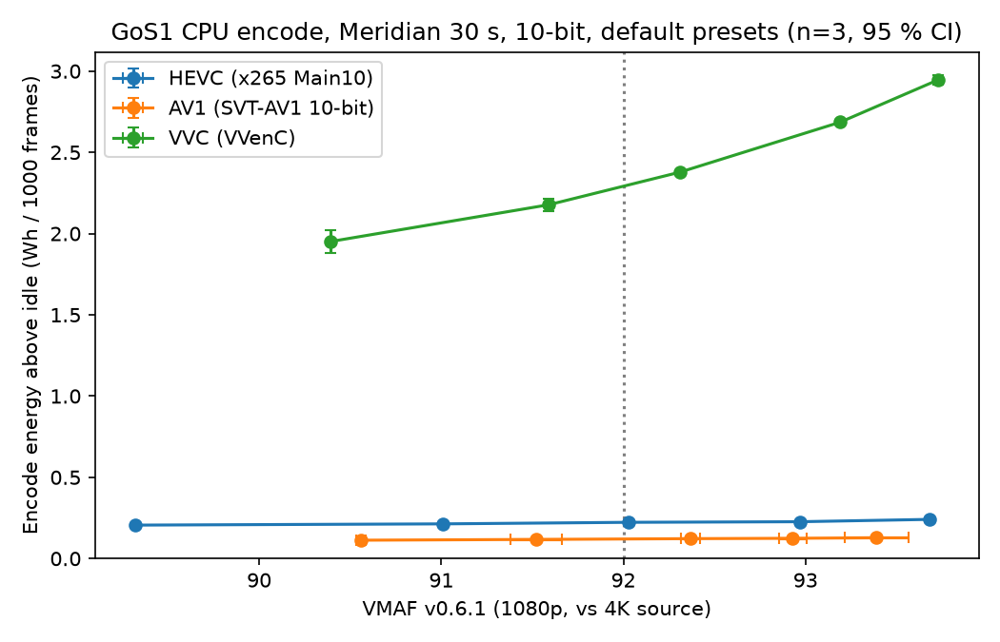
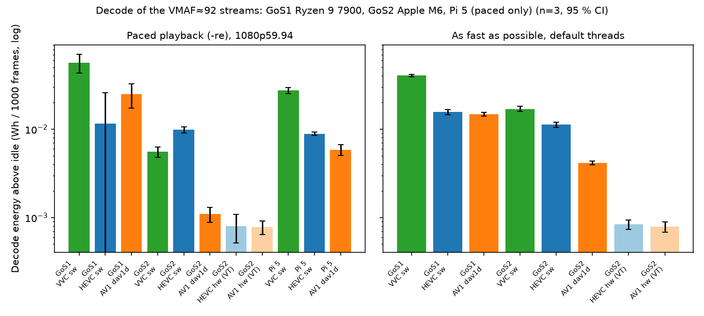

# MHV'27 VVC pilot: encode and decode energy, one night (2026-10-22)

*Pilot data for the ACM Mile-High Video 2027 abstract ("Early Insight"). Measured 2026-10-22 between 00:57 and
06:40 Paris on GoS1 and GoS2 (Pi 5 rows 10:57–11:10), under the revised run prompt [`mhv27-vvc-pilot_prompt.md`](mhv27-vvc-pilot_prompt.md).
Nothing here has been reviewed by Tania. It is not a finding, and nothing below has been catalogued on `/findings`.
Everything is **measured** unless it is marked *[inferred]*.*

Folder: [`mhv27_vvc_pilot/`](mhv27_vvc_pilot/). It holds the per-run CSVs (`runs_encode.csv`, `runs_decode.csv`),
the raw artifacts (`raw/`), the scripts (`scout.py`, `run_grid.py`, `decode_bench.py`, `analyse.py`), the full tables
(`summary.md`), the figures, the libvvenc config read-back and the Pi speed record.

## Affirmations (what we can stand behind)

1. 🟢 **At VMAF 92, VVenC (`medium`) saves bits but costs an order of magnitude more encode energy, and the gap widens
   on complex content.** These are default presets on a 24-thread Ryzen 9 7900, n=3 per point, 90/90 runs 🟢:
   - **Meridian:** 55 % fewer bits than x265 and 51 % fewer than SVT-AV1, for **10.3×** and **19×** the energy
     (conservative intervals 9.7–11.0× and 18.3–19.9×).
   - **Football:** 39 % and 30 % fewer bits, for **18×** and **47×** the energy (17.3–19.1× and 45.9–48.7×).
2. 🟡 **On an Apple M6, paced 1080p60 playback of the same VMAF-92 picture costs +1.23 W in VVC (software is the only
   path), against +0.17 W for HEVC or AV1 in hardware and +0.24 W for AV1 in software (dav1d).** That puts VVC at about 7× the
   hardware decoders (n=3; the VVC rows stay 🟢 after the fresh-sample correction, but the 0.17 W hardware rows drop to
   🟡/🔴, so the ratio is 🟡).
3. 🟢 **A Raspberry Pi 5 cannot decode this 1080p59.94 10-bit VVC stream in real time** with a current ffmpeg: it
   reaches 0.83× (50 fps) flat out (n=3, no throttling). Trying costs **+4.94 W, against +1.92 W for HEVC and +1.27 W for
   AV1 (dav1d)**, both of which play in real time (n=3 each, 9/9 🟢, still 🟢 on fresh samples). Per decoded frame that is
   ~3× HEVC and ~5× dav1d.

## 1. Operating points and versions

**Content.** `meridian_120s.mp4`: Netflix Meridian, H.264 **8-bit 4:2:0 SDR**, 3840×2160, 59.94 fps. The window is the first 30 s
(`parity.ensure_clip`, the SMPTE #4951 excerpt), and every encode outputs 1801 frames. Encoding a 10-bit output from an
8-bit source is a stated choice, not an HDR claim.

**Second clip, Football:** `football_35s.mp4`, H.264 8-bit 4:2:0, 3840×2160, **60 fps**. It is the SMPTE #4951 sport tier
(SI ~48, high spatial detail) and a **lab-internal source**: the measurements are publishable, the pictures are not. The
window is again the first 30 s, giving 1802 frames per encode. It has encode rows only; decode used the Meridian streams.

**Encode (GoS1, CPU only).** All three encoders use one shared chain, `scale=-2:1080,format=yuv420p10le`, then
`-b:v <target>`, GOP 120 closed with no scene cut, AAC 128k, and `nice -n -5`. Library defaults are otherwise untouched. The
values below were **read back from each encoder's own log**, not assumed.

| Encoder | Version | Preset | Rate control | GOP / intra | Adaptive QP | Threads |
|---|---|---|---|---|---|---|
| libx265 (Main10, L4.1) | 4.1+241-cfee9638 | medium (default) | ABR, 1 pass, lookahead 20 | `-g 120`, 2 B-frames, open-gop=0, scenecut=0 | AQ mode 2, cu-tree on | pool 24, 4 frame threads (~10 cores busy) |
| libsvtav1 (Main, 10-bit) | v4.1.0-7-gb486d839 | **8** (default) | **VBR**, 1 pass | gop 120, mini-GOP 16, scd=0 | AQ mode 2 | LP 6 (~14 cores busy) |
| libvvenc (Main 10, L4.1) | 1.15.0-dev | medium (default) | VBR, single pass, lookahead on | **IntraPeriod=120, IDR** (libvvenc ignores `-g`), GOP 32 | **QPA (perceptual) on** | **8 threads, 4 parallel frames (~5.8 cores busy)** |

The binary is ffmpeg-master `N-124403-g28ecb07e55-20260507` (BtbN static, the binary used for SMPTE #4951). The OWL code
is `813e699`, which adds a `vvc` codec and an opt-in 10-bit chain to `parity.py`. VMAF is **v0.6.1** with both sides
pinned to yuv420p10le, scored by `ffmpeg-score-20260717` after the energy window has closed. Pinning gave the same
scores as ffmpeg's automatic format negotiation, to two decimals.

**Decode.** The streams are the scout encodes nearest VMAF 92, with the exact grid commands:
`vvc_500k` (478 kb/s, VMAF 92.31), `hevc_1000k` (987 kb/s, 92.03) and `av1_1500k` (1009 kb/s actual, 92.39). All are
1080p59.94 10-bit, 1801 frames, and sha256-checked on every node (`raw/SHA256SUMS`). The command is `ffmpeg [-re] [-threads 1] -c:v <dec>
-i S -an -f null -` with default threads; as-fast-as-possible (AFAP) rows repeat until the window is ≥ 20 s.

| Node | ffmpeg | Decoders |
|---|---|---|
| GoS1: Ryzen 9 7900 (24 threads), RTX 5080 idle, Ubuntu 24.04 | ffmpeg-master N-124403 | native `vvc`, native `hevc`, `libdav1d` (git aa45047) |
| GoS2: Apple M6 Mac mini (12 cores, 24 GB), macOS 27.0.1 | Homebrew ffmpeg 9.0.2 (dav1d 1.5.4) | the same three, plus **VideoToolbox** HEVC and AV1 hardware decode (verified: `videotoolbox_vld` chosen, and the native AV1 decoder fails without it). `VTIsHardwareDecodeSupported`: HEVC yes, AV1 yes, **VVC no**. |
| Pi 5 (4× Cortex-A76, 16 GB), Raspberry Pi OS Bookworm | BtbN linuxarm64 `N-127900-ge2798d5cad-20261021`, staged in `/dev/shm` (system 5.1.9 untouched) | native `vvc`, native `hevc`, `libdav1d` |

**Protocol (both nodes).** The pattern follows `docs/smpte_2026/run_clean_sweep.py`:
- Each node runs under its own focus mode, lock, Lab-session flag and paused live poller.
- Baselines are 5 polls. The wait-for-idle is real (`power.cooldown_between_runs`).
- `baseline_elevated` is kept on every row (0 of 117 rows were elevated). Page-cache eviction runs before each row on Linux.
- Reps run as **whole passes** over the matrix, never back to back.
- ΔW is the dual-meter `ci2` combine: GoS1 inner `.91` + outer `.159`; GoS2 inner lab-G3 `.11` + outer lab-G2 `.22`.

Energy is the marginal ΔE above each node's own idle floor (GoS1 ~77 W, GoS2 ~1.3 W) at the wall.

## 2. Encode results (GoS1) — Meridian (left panel) and Football (right panel, §2b)



Per point: mean ± 95 % t-CI over n=3. All 45 runs are 🟢 and none had an elevated baseline (`summary.md` has the full table).

| Codec | Target → actual kb/s | VMAF v0.6.1 | Wh / 1000 frames | ΔW (W) | Encode s / pass |
|---|---|---|---|---|---|
| HEVC x265 | 600 → 593 | 89.32 | 0.206 ± 0.009 | 66.0 | 20.2 |
| | 800 → 790 | 91.01 | 0.213 ± 0.010 | 66.4 | 20.8 |
| | 1000 → 987 | 92.03 | 0.223 ± 0.013 | 67.3 | 21.5 |
| | 1300 → 1283 | 92.97 | 0.227 ± 0.005 | 65.8 | 22.3 |
| | 1700 → 1678 | 93.68 | 0.241 ± 0.015 | 66.8 | 23.4 |
| AV1 SVT | 800 → 538 | 90.56 | 0.113 ± 0.005 | 64.9 | 11.2 |
| | 1100 → 750 | 91.52 | 0.118 ± 0.003 | 65.8 | 11.6 |
| | 1500 → 1009 | 92.37 | 0.122 ± 0.005 | 66.2 | 12.0 |
| | 2000 → 1359 | 92.93 | 0.125 ± 0.006 | 65.9 | 12.2 |
| | 2800 → 1900 | 93.39 | 0.128 ± 0.005 | 65.4 | 12.7 |
| VVC VVenC | 300 → 289 | 90.39 | 1.951 ± 0.073 | 68.8 | 183.8 |
| | 400 → 384 | 91.59 | 2.177 ± 0.039 | 69.5 | 203.3 |
| | 500 → 478 | 92.31 | 2.378 ± 0.005 | 69.5 | 221.9 |
| | 700 → 668 | 93.19 | 2.685 ± 0.015 | 69.5 | 250.5 |
| | 900 → 853 | 93.73 | 2.947 ± 0.029 | 69.5 | 275.0 |

**At VMAF 92.** Values are linear interpolation between the bracketing points, as in `make_iso_vmaf_table.py`. The first
interval is a bootstrap over reps (10,000 draws). The second, more conservative one interpolates the per-point t-CI bounds
and pairs their extremes. It is the one to quote, because a bootstrap over n=3 understates spread.

| Codec | kb/s @ VMAF 92 | Wh / 1000 frames @ VMAF 92 [bootstrap] | conservative |
|---|---|---|---|
| HEVC (x265 Main10) | 981 | 0.223 [0.218, 0.227] | [0.210, 0.235] |
| AV1 (SVT-AV1, preset 8) | 896 [877, 916] | 0.120 [0.119, 0.121] | [0.116, 0.124] |
| VVC (VVenC medium) | 437 | 2.29 [2.28, 2.30] | [2.27, 2.31] |

| VVC vs … at VMAF 92 | Energy ratio | Bitrate change |
|---|---|---|
| HEVC | **10.3×** (bootstrap 10.1–10.5; conservative **9.7–11.0**) | **−55 %** |
| AV1 | **19.0×** (bootstrap 18.9–19.2; conservative **18.3–19.9**) | **−51 %** [−52, −50] |

**At matched bitrate** (700 kb/s actual, inside every codec's measured range): VVC uses 13.0× [12.9, 13.2] the energy of HEVC and
23.5× [23.3, 23.7] that of AV1. VVC delivers VMAF 93.3 against 90.2 (HEVC) and 91.3 (AV1).

For SMPTE #4951 comparability, in Wh per minute of content (× 3.596): HEVC 0.80, AV1 0.43 and VVC 8.24 at VMAF 92. The
#4951 clean-sweep 8-bit rows for Meridian were HEVC ~0.61 at its lowest rung (VMAF 92.6) and AV1 ~0.35 at VMAF ~92.1. The
10-bit chain costs more, *[inferred]* partly from Main10 itself. These rows are new measurements and are not interchangeable with #4951.

**Reading the encode result.**
- **ΔW is nearly flat (65–70 W) across codecs and bitrates, so encode energy here is wall time.** VVenC takes 18× as
  long per pass as SVT-AV1 at roughly the same draw. The package seems to sit near a common power ceiling whether 6 or 14
  cores are busy *[inferred]*.
- **Energy rises with bitrate within each codec (+17 % HEVC, +13 % AV1, +51 % VVC across the ladders).** VVenC is the
  most bitrate-sensitive.
- **The ratio is an operating-point result, not a codec constant.** SVT-AV1 preset 8 sits at the fast end of its dial
  (0–13) and x265 medium at mid-dial. VVenC medium uses only 8 of 24 threads by default. VVenC `faster`/`fast`, a higher
  thread count, or slower x265/SVT presets would all move the ratio (the encode-levers draft finding shows presets move
  energy several-fold).

### 2b. Football (encode only)

All 45 runs 🟢, none elevated. The ladders came from an unmetered scout, as for Meridian (`grid_plan_football.json`).

| Codec | Target → actual kb/s | VMAF v0.6.1 | Wh / 1000 frames | ΔW (W) | Encode s / pass |
|---|---|---|---|---|---|
| HEVC x265 | 5000 → 5001 | 87.66 | 0.335 ± 0.006 | 70.3 | 30.9 |
| | 7000 → 6969 | 90.53 | 0.364 ± 0.007 | 70.1 | 33.7 |
| | 9000 → 8928 | 92.16 | 0.390 ± 0.012 | 70.0 | 36.1 |
| | 11000 → 10886 | 93.18 | 0.419 ± 0.004 | 71.1 | 38.3 |
| | 14000 → 13820 | 94.17 | 0.450 ± 0.018 | 70.9 | 41.2 |
| AV1 SVT | 5000 → 4945 | 89.20 | 0.148 ± 0.005 | 69.7 | 13.8 |
| | 7000 → 6878 | 91.51 | 0.150 ± 0.002 | 69.4 | 14.0 |
| | 9000 → 8691 | 92.79 | 0.147 ± 0.002 | 69.8 | 13.7 |
| | 12000 → 10992 | 93.71 | 0.157 ± 0.004 | 68.9 | 14.8 |
| | 15000 → 13167 | 94.30 | 0.151 ± 0.017 | 69.3 | 14.1 |
| VVC VVenC | 3500 → 3271 | 88.43 | 5.611 ± 0.073 | 68.1 | 534.6 |
| | 4500 → 4181 | 90.46 | 6.380 ± 0.144 | 69.3 | 597.1 |
| | 5500 → 5067 | 91.78 | 6.893 ± 0.140 | 68.7 | 651.2 |
| | 7000 → 6395 | 93.05 | 7.753 ± 0.070 | 69.4 | 724.8 |
| | 9000 → 8258 | 94.18 | 8.837 ± 0.033 | 69.6 | 824.1 |

| At VMAF 92 | kb/s | Wh / 1000 frames [bootstrap] | conservative |
|---|---|---|---|
| HEVC | 8735 | 0.387 [0.382, 0.390] | [0.376, 0.399] |
| AV1 | 7571 [7551, 7593] | 0.149 [0.149, 0.150] | [0.147, 0.151] |
| VVC | 5297 | 7.04 [6.99, 7.07] | [6.91, 7.17] |

| VVC vs … at VMAF 92 | Energy ratio | Bitrate change |
|---|---|---|
| HEVC | **18.2×** (bootstrap 18.0–18.4; conservative **17.3–19.1**) | **−39 %** |
| AV1 | **47.3×** (bootstrap 46.9–47.6; conservative **45.9–48.7**) | **−30 %** |

At matched bitrate (6650 kb/s actual), VVC uses 22.0× the energy of HEVC and 52.7× that of AV1, at VMAF 93.2 against 90.1 / 91.2.
In Wh per minute of content (× 3.6, 60 fps) at VMAF 92: HEVC 1.39, AV1 0.54, VVC 25.3.

**Across the two clips:**
- **VVC's bitrate advantage shrinks on the harder content** (−55 → −39 % vs HEVC, −51 → −30 % vs AV1).
- **Its energy premium grows** (10 → 18× vs HEVC, 19 → 47× vs AV1). SVT-AV1 preset 8 barely slows down on
  Football (12.0 → 13.7 s per pass), while VVenC slows almost 3× (222 → 651 s).
- Two clips can't give a trend; this is two data points, stated as such.

## 3. Decode results



Per cell: mean ± 95 % t-CI, n=3. "fresh" is the flag recomputed on fresh samples (P110 fw 1.3.1 repeats readings about
every 2 s below ~12 W), using each node's own settings.

| Node | Decoder | Regime | ΔW (W) | Wh / 1000 frames | speed× | flags | fresh |
|---|---|---|---|---|---|---|---|
| GoS1 | VVC (sw) | paced | 12.60 ± 3.06 | 0.0569 ± 0.0139 | 1.03 | 🟢🟢🟢 | 🟢🟢🟢 |
| GoS1 | HEVC (sw) | paced | 2.54 ± 3.14 | 0.0116 ± 0.0144 | 1.02 | 🔴🟢🟢 | 🔴🟢🟡 |
| GoS1 | AV1 dav1d | paced | 5.46 ± 1.68 | 0.0249 ± 0.0077 | 1.02 | 🟢🟢🟢 | 🟢🟢🟢 |
| GoS1 | VVC (sw) | AFAP | 68.14 ± 2.28 | 0.0405 ± 0.0013 | 8.09 | 🟢🟢🟢 | 🟢🟢🟢 |
| GoS1 | HEVC (sw) | AFAP | 66.03 ± 4.02 | 0.0157 ± 0.0010 | 19.8 | 🟢🟢🟢 | 🟢🟢🟢 |
| GoS1 | AV1 dav1d | AFAP | 65.44 ± 2.26 | 0.0148 ± 0.0007 | 21.0 | 🟢🟢🟢 | 🟢🟢🟢 |
| GoS1 | VVC (sw) | AFAP, 1 thread | 29.75 ± 0.70 | 0.0893 ± 0.0021 | **1.56** | 🟢🟢🟢 | 🟢🟢🟢 |
| GoS1 | HEVC (sw) | AFAP, 1 thread | 30.94 ± 3.14 | 0.0258 ± 0.0025 | 5.64 | 🟢🟢🟢 | 🟢🟢🟢 |
| GoS1 | AV1 dav1d | AFAP, 1 thread | 30.17 ± 0.58 | 0.0150 ± 0.0003 | 9.43 | 🟢🟢🟢 | 🟢🟢🟢 |
| GoS2 | VVC (sw) | paced | **1.23 ± 0.16** | 0.0056 ± 0.0008 | 1.03 | 🟢🟢🟢 | 🟢🟢🟢 |
| GoS2 | HEVC (sw) | paced | 2.16 ± 0.18 | 0.0099 ± 0.0008 | 1.02 | 🟢🟢🟢 | 🟢🟢🟢 |
| GoS2 | AV1 dav1d | paced | 0.24 ± 0.04 | 0.0011 ± 0.0002 | 1.02 | 🟢🟢🟢 | 🟢🟢🟢 |
| GoS2 | HEVC hw (VT) | paced | **0.17 ± 0.05** | 0.0008 ± 0.0003 | 1.02 | 🟢🟢🟢 | 🟡🟢🟡 |
| GoS2 | AV1 hw (VT) | paced | **0.17 ± 0.02** | 0.0008 ± 0.0001 | 1.02 | 🟢🟢🟢 | 🔴🟡🟡 |
| GoS2 | VVC (sw) | AFAP | 34.18 ± 2.35 | 0.0170 ± 0.0012 | 9.48 | 🟢🟢🟢 | 🟢🟢🟢 |
| GoS2 | HEVC (sw) | AFAP | 33.15 ± 2.06 | 0.0113 ± 0.0007 | 13.8 | 🟢🟢🟢 | 🟢🟢🟢 |
| GoS2 | AV1 dav1d | AFAP | 26.20 ± 1.42 | 0.0042 ± 0.0002 | 29.8 | 🟢🟢🟢 | 🟢🟢🟢 |
| GoS2 | HEVC hw (VT) | AFAP | 2.02 ± 0.27 | 0.0008 ± 0.0001 | 11.4 | 🟢🟢🟢 | 🟢🟢🟢 |
| GoS2 | AV1 hw (VT) | AFAP | 1.82 ± 0.21 | 0.0008 ± 0.0001 | 10.95 | 🟢🟢🟢 | 🟢🟢🟢 |
| GoS2 | VVC (sw) | AFAP, 1 thread | 12.02 ± 0.10 | 0.0292 ± 0.0002 | **1.92** | 🟢🟢🟢 | 🟢🟢🟢 |

(Single-thread rows for HEVC, dav1d and the VT arms on GoS2 are in `summary.md`.)

**Reading the decode result.**
- **Playback (paced) is the regime that matters for a viewer.** On the M6, VVC sits at 1.23 W:
  - ~7× the hardware decoders (0.17 W) and ~5× dav1d (0.24 W);
  - 0.57× software HEVC (2.16 W), which is unexpectedly expensive here. Whether that is ffmpeg's 10-bit HEVC
    path on Apple silicon or something else was not tested *[inferred]*.
- **On GoS1, paced decode is resolvable but noisy**, because the idle floor is 77 W. VVC shows +12.6 W against dav1d's +5.5 W.
  The HEVC paced cell has a 🔴 run and can't be ranked.
- **As fast as possible, VVC costs 2.6× (GoS1) and 1.5× (GoS2) as much per frame as software HEVC, and 2.7× / 4.1× dav1d.**
- **Real-time headroom.** One core sustains VVC 1080p60 at 1.56× on the Ryzen and 1.92× on the M6. The Pi 5's four A76
  cores reach 0.83× (§5).

## 4. Traffic-light status of each statement

| Statement | Status | Why |
|---|---|---|
| VVenC vs x265/SVT-AV1 encode energy at VMAF 92 (Meridian 10.3× / 19×; Football 18× / 47×) | 🟢 | n=3 per point, 90/90 🟢, conservative CIs within ±7 %. Two clips, one host, defaults. |
| VVC bitrate saving at VMAF 92 (Meridian −55 % / −51 %; Football −39 % / −30 %) | 🟢 (as measured) | VMAF and bitrate are essentially deterministic. Two clips, so not a general BD-rate. |
| M6 paced decode: VVC ≈ 7× hardware HEVC/AV1 | 🟡 | VVC side 🟢; the hardware side (0.17 W) drops to 🟡/🔴 on fresh samples. |
| M6 paced decode: VVC ≈ 5× dav1d | 🟢 | Both cells 🟢 on fresh samples. |
| GoS1 paced decode ranking | 🟡 | VVC and dav1d 🟢; HEVC cell not confident. |
| AFAP decode ratios (both hosts) | 🟢 | All cells 🟢, CIs small. |
| Pi 5 can't sustain real-time VVC 1080p60 10-bit | 🟡 | Speed n=3 and consistent, no throttling. One build, one stream; speed was measured unmetered, outside the energy runs. |
| Pi 5 paced decode: VVC +4.94 W vs HEVC +1.92 W / dav1d +1.27 W | 🟢 | 9/9 🟢, also on fresh samples. The VVC row is a decoder running below real time, not valid playback. |

## 5. Pi 5 (paced decode energy + speed)

**Energy** was measured through OWL's own `/decode` pipeline (batch `9589624c2902`, 9 jobs, 2026-10-22 10:57–11:10 Paris, rig
P110 lab-F2 `.184`, fw 1.3.1). Each job runs a 15 s settle, a 20 s baseline and a **45 s paced window** (`ffmpeg -nostdin -re
-i … -an -f null -`), with the idle guard. The clips are the three decode streams looped once to 60 s by stream copy, since the
upload template needs ≥ 45 s. The `ffmpeg` on the Pi resolved to the staged N-127900 build through a temporary,
owner-approved PATH line in the Pi's `~/.bashrc`, removed straight after (system ffmpeg 5.1.9 untouched). Envelopes are in
`raw/pi5/`. Reps ran as whole passes.

| Pi 5, paced | ΔW (W) | Wh / 1000 frames | speed× | flags | fresh |
|---|---|---|---|---|---|
| VVC (sw) | **4.94 ± 0.41** | 0.0275 ± 0.0023 *[frames inferred from 0.83×]* | 0.83 | 🟢🟢🟢 | 🟢🟢🟢 |
| HEVC (sw) | 1.92 ± 0.08 | 0.0089 ± 0.0004 | 1.02 | 🟢🟢🟢 | 🟢🟢🟢 |
| AV1 dav1d | 1.27 ± 0.18 | 0.0059 ± 0.0008 | 1.02 | 🟢🟢🟢 | 🟢🟢🟢 |

The Pi idled at 3.0–3.1 W. Its Wi-Fi interface was up alongside Ethernet in every window, and the board also runs Pi-hole
(LAN DNS); both are constant across rows and disclosed per rig convention. Per-frame values use window × 59.94 fps × speed.
For VVC the speed comes from the unmetered check below, not from the metered run (the rig harness does not record `speed=`).

**Speed**, unmetered, n=3 for VVC and n=1 for the others (`mhv27_vvc_pilot/pi5_speed_unmetered.txt`):

| Pi 5 | VVC | HEVC | AV1 dav1d |
|---|---|---|---|
| Flat out (speed×) | 0.832 / 0.835 / 0.828 | 2.29 | 2.7 |
| Paced (`-re`) | 0.828 (cannot hold 1×) | 1.02 | 1.02 |

The first static build tried (johnvansickle, June 2024) still marks VVC as experimental and predates most of the decoder's
speed work, so it was discarded in favour of the current BtbN build. These are the "can't sustain real time" result the
prompt asked for, reported as is, not tuned around.

## 6. What was cut, and why

- **Grid: nothing cut.** The full 3 codecs × 5 bitrates × n=3 ran on Meridian (projected about 2.5 h, actual 1 h 28 min)
  and on Football (3 h 22 min).
- **Pi energy rows: run on the morning of 2026-10-22**, after the owner approved the temporary PATH line (§5). Paced only;
  no AFAP rows on the Pi.
- **Football: run** (encode only, the prompt's optional addition; 45 rows, 03:18–06:40).
- **Extras that were run:** single-thread AFAP arms on both hosts, AFAP rows on GoS2, and GoS2's hardware decode arms.

## 7. What this does not show

- **Two clips** (Meridian, low complexity; Football, high detail; 30 s each), **one encode host** (Ryzen 9 7900),
  **CPU encode only**. Decode used Meridian streams only. No VVC hardware
  encoder exists on either node.
- **8-bit SDR source → 10-bit encodes.** No HDR, and VMAF v0.6.1 is an SDR model.
- **Default presets and threading.** These are three different points on three dials. VVenC used 8 of 24 threads; perceptual
  QPA is on by default, which optimises for XPSNR rather than VMAF *[inferred: could understate VVC on VMAF]*.
- **Decode streams sit at one quality point** (VMAF ≈ 92), at different bitrates per codec.
- **GoS2 and Pi 5 rows use fw 1.3.1 P110s**, which refresh about every 2 s below ~12 W, and P110 accuracy around 1 W is unverified against a
  reference meter. GoS1 paced rows sit near the floor of a 77 W idle.
- **Device layer only.** Network, CDN and CPE are excluded. Energy only, no CO2e.
- **No client STB / TV decode.** No rig box can play VVC today (capabilities digest §3).

## 8. Reproduce

```bash
python3 docs/digests/mhv27_vvc_pilot/scout.py vvc 350 500 700        # unmetered bitrate → VMAF + wall time
python3 docs/digests/mhv27_vvc_pilot/run_grid.py --plan docs/digests/mhv27_vvc_pilot/grid_plan.json
python3 docs/digests/mhv27_vvc_pilot/decode_bench.py --streams /srv/data/owl/mhv27_vvc_pilot/streams \
    --out /srv/data/owl/mhv27_vvc_pilot/gos1_decode.jsonl --arms vvc,hevc,dav1d --threads1
/srv/data/owl/figenv/bin/python docs/digests/mhv27_vvc_pilot/analyse.py
```

On GoS2, run `decode_bench.py` from `~/wattlab` with `~/owl/venv/bin/python`, held by an **open** ssh session from GoS1.
macOS blocks LAN access (the meters) for processes that outlive their ssh session.
